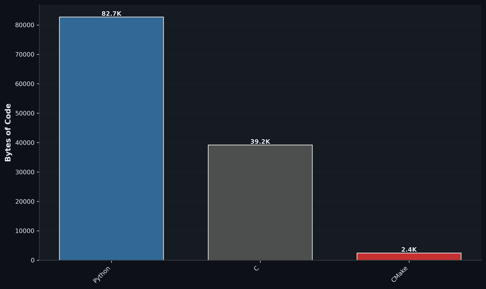

 

# Low Level Learner

---

## Interests

- Machine learning
- Graphics and native applications
- Compilers and programming languages
- Low-level programming
- Operating systems and computer architecture
- Open source Projects

## Languages

      

## Systems & Development

    

## Machine Learning & Data

    

## Tools

   

## Editors & IDEs

      

## Hardware

 

## Other

     

---

## GitHub Activity

 

